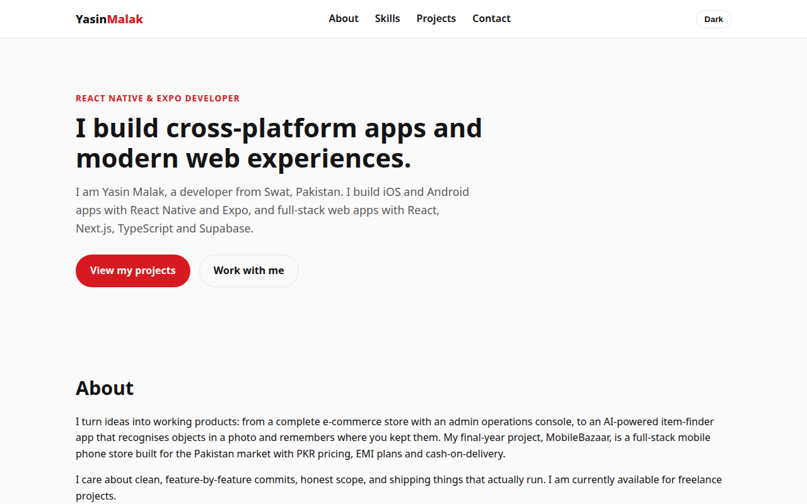
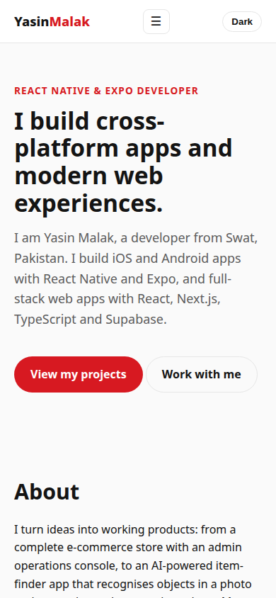
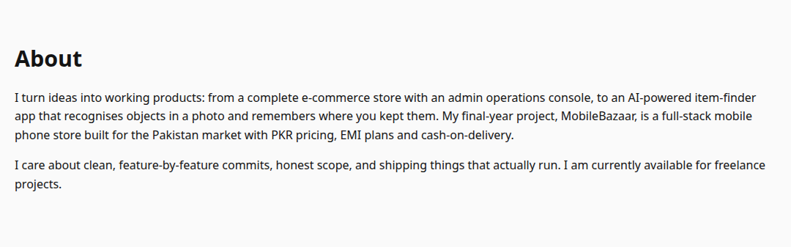
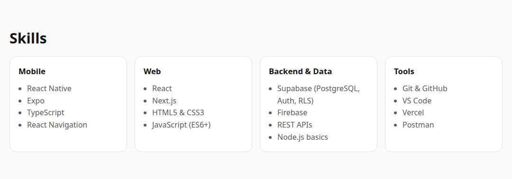
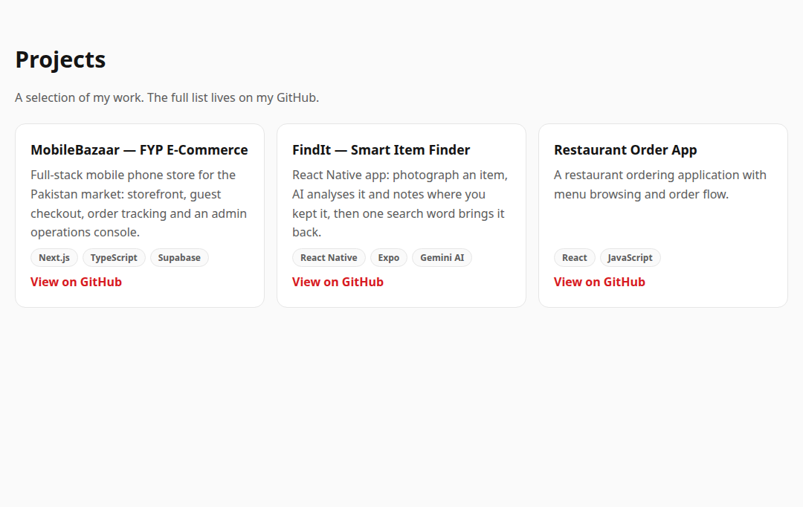
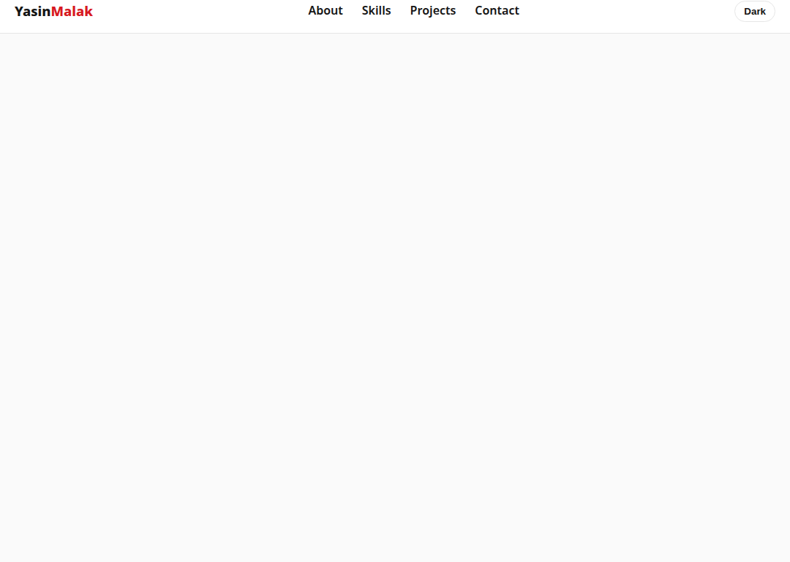

# Personal Portfolio Site

The personal portfolio website of **Yasin Malak** — React Native & Expo developer based in Swat, Pakistan.

**Live:** https://yasinmkdev.github.io/personal-portfolio-site/ (GitHub Pages)

## Built with
Plain HTML5, CSS3 and vanilla JavaScript — no frameworks, no build step. A foundations project done properly: semantic markup, responsive layout, and progressive enhancement.

## Features
- Semantic page structure (header, nav, main, sections, footer)
- Responsive layout with CSS Flexbox and Grid, mobile navigation menu
- Projects grid rendered from a data file (`js/projects-data.js`)
- Contact form with client-side validation and inline error messages
- Dark mode toggle persisted in localStorage
- Scroll-reveal animations with `prefers-reduced-motion` support
- Accessibility: skip link, visible focus states, aria labels
- SEO: meta description, OpenGraph tags, SVG favicon

## Screens

Single-page site: hero, About, Skills, Projects (rendered from `js/projects-data.js`), and Contact.








## Run locally
Open `index.html` in a browser, or serve the folder:
```
npx serve .
```

## Structure
- `index.html` — page structure and content
- `styles.css` — design tokens, layout, themes, responsive rules
- `js/projects-data.js` — project list data
- `js/main.js` — navigation, rendering, form validation, theme, reveal
